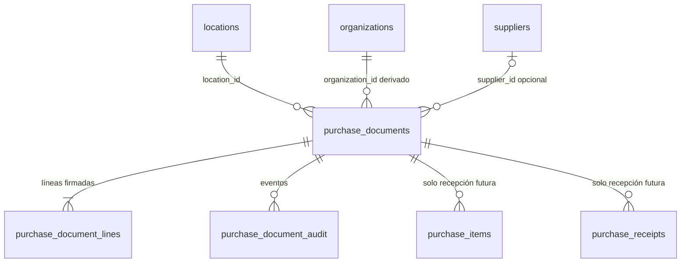

# Persistencia de facturas de inventario

SENDA OPS — Pasos 288–295. Propuesta técnica. **No ejecutar SQL. No implementar endpoints.**

Alcance: guardar comprobantes que contienen mercadería inventariable. El análisis con Gemini ya existe. Recibir stock es un paso posterior e independiente.

Enmiendas del Paso 289 (aprobadas en arquitectura):

- Mercadería **sin mapear** a `inventory_products` sí se guarda. Queda `mapping_status = unmapped`. No entra a stock hasta vincular. No se crean productos.
- Documentos **solo de servicios** no se guardan.
- Tolerancias fiscales **por moneda**, configurables. Importes extraídos intactos. Diferencias relevantes requieren confirmación explícita.
- Duplicado = identidad fiscal del comprobante **o** mismo hash. Dos archivos distintos no son dos facturas si el comprobante es el mismo.

Enmiendas del Paso 290 (inspect aplicado):

- Estados del CHECK real: guardar = `reviewed`, anular = `cancelled`, stock = `received`. No usar `saved` ni `voided`.
- Organización derivada del local. Proveedor, si existe, de la misma org.
- Permisos mínimos: SELECT/INSERT/UPDATE de documentos y líneas; auditoría INSERT+SELECT. Sin DELETE. `original_analysis` inmutable.
- Únicos parciales con `status is distinct from 'cancelled'`.
- `received` bloqueado por trigger hasta el paso de stock. Cantidad física de línea ≥ 0.

Enmiendas del Paso 291 (auditoría del SQL):

- `cancelled` es terminal (`CANCELLED_TERMINAL`). INSERT solo `draft` | `reviewed`.
- Tras anular: no INSERT/UPDATE de líneas (trigger + RLS). Auditoría con trigger `AUDIT_APPEND_ONLY` en UPDATE/DELETE.
- Identidad fiscal y puntero Storage inmutables tras el INSERT. `organization_id` se congela en UPDATE.
- Único fiscal con `coalesce(voucher_type,'')` y `coalesce(point_of_sale,'')` para no eludir NULLs.
- Importe documental negativo ⇒ `inventory_physical_quantity = 0`.
- UPDATE autenticado por columna: cabecera `status, notes`; líneas solo mapeo.

Enmiendas del Paso 292 (integridad de escritura):

- El cliente **no inserta** cabecera, líneas ni auditoría. Solo `SELECT`. Las RPC de escritura no son `EXECUTE` de `authenticated`.
- `senda_save_purchase_invoice(jsonb)` (SECURITY DEFINER, una transacción): `draft` → líneas → `reviewed` → audit. PostgREST no agrupa INSERTs sueltos.
- INSERT de líneas solo con padre `draft`. Tras `reviewed` no se agregan líneas.
- Cabecera `reviewed` incompleta rechazada: análisis original, hash SHA-256 de 64 hex, Storage, HMAC snapshot, ≥1 línea elegible.
- HMAC lo verifica el **backend**. PostgreSQL exige que los campos existan; no conoce el secreto.
- Auditoría: sin INSERT para `authenticated`. `actor_user_id` = UUID verificado por el backend. Acciones cerradas.
- `inventory_products.organization_id` debe coincidir con la org del documento.
- Tras `reviewed`, documental congelado. Mutable: mapeo de líneas elegibles + `unmapped_line_count`, o anular. Tras `cancelled`: nada.

Enmiendas del Paso 293 (cierre):

- Membresía `SECURITY DEFINER` con `senda_actor_is_purchase_member(location, user_id)`. Las RPC no usan `current_user`.
- CHECK: sin `inventory_product_id` ⇒ `inventory_physical_quantity = 0`. El mapeo fuerza 0 al desvincular.
- `FOR UPDATE` de la cabecera en anular y mapear (mismo orden: documento, luego línea).
- Auditoría armada en servidor (`jsonb_build_object`). No se persiste `audit_payload` del cliente.

Enmiendas del Paso 294 (cierre de confianza del guardado):

- `authenticated` no tiene `EXECUTE` de `senda_save_purchase_invoice`, `senda_cancel_purchase_invoice` ni `senda_map_purchase_document_line`.
- Identidad privilegiada: `getSupabaseAdmin()` + `SUPABASE_SERVICE_ROLE_KEY` (solo API, nunca el frontend).
- Las RPC exigen `auth.role() = 'service_role'` y un `actor_user_id` que el backend toma de `auth.getUser` (JWT del usuario), no del body del browser.
- Membresía y auditoría usan ese UUID. HMAC / fiscal / documental se validan en la API **antes** de llamar al RPC.
- Anulación y mapeo cierran el mismo agujero (misma identidad privilegiada + actor).

Enmiendas del Paso 295 (archivos para ejecución):

- Migración definitiva: `apps/api/sql/migrate-invoice-persistence.sql`.
- Verificación posterior de solo lectura: `apps/api/sql/verify-invoice-persistence.sql`.
- No se ejecuta SQL. No hay endpoints. No hay bucket.

Estado de base (inspect 289, confirmado):

- `purchase_documents`: 10 columnas originales. CHECK `status IN ('draft','reviewed','received','cancelled')`.
- `purchase_documents`, `purchase_items`, `purchase_receipts`, `suppliers`: 0 filas.
- 1 organización, 2 locales de esa org.
- RLS habilitado. Cero políticas en tablas de compras. Grants SQL amplios (hay que recortar DELETE).
- No existen `purchase_document_lines`, `purchase_document_audit`, `purchase_documents_assign_organization()`, triggers ni vistas dependientes.
- `apps/api/sql/proposed-invoice-persistence.sql` obsoleto. No usarlo.
- `apps/api/sql/proposed-invoice-persistence-289.sql` supersedido. No usarlo.
- Migración definitiva (cuando se autorice): `apps/api/sql/migrate-invoice-persistence.sql`.
- Verificación posterior (solo lectura): `apps/api/sql/verify-invoice-persistence.sql`.
- `inventory_products`: `id`, `organization_id` (NOT NULL, FK `organizations`), `name`, `base_unit`, `active`, `created_at`. OpenAPI confirmado.

---

## A. Contrato funcional

### A.1 Analizar (ya implementado)

`POST /api/invoices/analyze` — `multipart/form-data` con un único campo `file` (PDF o imagen, máx. 10 MB).

- Autenticación: JWT Bearer. Membresía: el usuario debe ver al menos una fila en `organizations` vía RLS.
- No recibe `organizationId` ni `locationId`.
- Gemini corre solo en el backend. Respuesta `{ data: InvoiceAnalysisApiResult }`.
- `metadata.fileSha256` se calcula de los bytes recibidos.
- Si existe `INVOICE_ANALYSIS_HMAC_SECRET`, se emiten `integrityToken`, `snapshotSha256` e `integrityExpiresAt` (TTL 2 h). El secreto no sale al cliente.
- No escribe PostgreSQL ni Storage. No toca inventario.

### A.2 Revisar (frontend actual + contrato futuro)

Hoy: `InvoiceReview` muestra cabecera, líneas particionadas, totales, advertencias, inventario y bonificaciones temporales. No hay visor del original, ni edición de líneas, ni Cancelar/Guardar.

Pantalla objetivo (no implementar en este paso):

| Zona | Contenido |
|---|---|
| Izquierda | Original (PDF/imagen) |
| Derecha | Proveedor, CUIT, tipo, número, fecha, moneda, local, clasificación, SHA-256 corto |
| Debajo | Desglose editable de productos (conceptos). Impuestos y totales de solo lectura salvo corrección explícita de OCR |
| Lateral / inferior | Advertencias, conciliación fiscal con diferencia visible, decisiones comerciales |
| Acciones | Cancelar factura · Guardar factura (este último solo si hay productos de inventario válidos) |

**Cancelar** antes de persistir: descarta estado local. Cero escrituras.

**Documento sin productos de inventario** (MetroGAS y equivalentes):

- Título: «Documento sin productos de inventario».
- No hay botón Guardar factura.
- Acción: cargar otro documento (limpia archivo + análisis).
- No hay `POST` de guardado.

Criterio servidor (fuente de verdad, no el badge del navegador):

```
eligibleLines >= 1
```

después de aplicar correcciones y decisiones comerciales sobre el snapshot original. `eligible` = `inventoryEligibility === 'eligible'` recalculado por `analyzeExtractedInvoice` / `interpretCommercialInvoice`.

Esas líneas **no necesitan** `inventory_product_id`. Sin vínculo al catálogo se guardan como mercadería sin mapear (`mapping_status = unmapped`, `unmapped_line_count > 0`). No habilitan «actualizar stock».

Líneas `pending_review` (clasificación ambigua) no cuentan como elegibles. El usuario puede reclasificar a mercadería; el servidor vuelve a evaluar.

### A.3 Guardar (a implementar después de aprobar)

`POST /api/invoices` propuesto.

**Recibe** (`multipart/form-data`):

| Campo | Origen | Confianza |
|---|---|---|
| `file` | mismos bytes analizados | se rehashea |
| `locationId` | selector | se reautoriza; no se usa como org |
| `integrityToken` | metadata del análisis | HMAC |
| `originalSnapshot` | JSON del `data` de analyze | debe coincidir con el token |
| `corrections` | JSON overlay | permitido, validado |
| `commercialDecisions` | JSON | solo confirm/reject de relaciones del snapshot |
| `acceptFiscalInconsistency` | `'true'` opcional | obligatorio si, con la política de la moneda, el status fiscal es `inconsistent` |

No se acepta `organizationId` del cliente. Si viene, se ignora.

**Valida, en este orden:**

1. JWT + `createSupabaseUserClient` → `auth.getUser`. Identidad real del usuario. Lectura de local con RLS (no `service_role`).
2. `locations.id = locationId` visible por RLS → org del local.
3. HMAC: usuario, expiración, hash del archivo, hash canónico del snapshot (sin `integrityToken` / `expiresAt` / `snapshotSha256`).
4. `assertCommercialDecisions` contra el snapshot firmado.
5. Overlay `corrections` contra ids de líneas existentes; enums permitidos; no se aceptan líneas nuevas inventadas por el cliente.
6. Recalcular interpretación + validación + conciliación **en el servidor**.
7. Si `eligibleLines < 1` → `422 SAVE_NOT_ALLOWED_NO_INVENTORY`.
8. Duplicados, en este orden:
   - Mismo `(org, file_sha256)` no `cancelled` → reintento idempotente (200, mismo id).
   - Misma identidad fiscal `(org, CUIT, tipo, PV, número)` no `cancelled`, **aunque el archivo sea otro** → 409 `DUPLICATE_DOCUMENT`. No es una segunda factura.
   - Si el número/CUIT no se pudo parsear, solo rige el hash (riesgo: dos scans del mismo comprobante con hashes distintos y cabecera incompleta).

**Persiste, en una sola llamada RPC** (`senda_save_purchase_invoice`). No es un INSERT REST ni varias peticiones supabase-js:

1. INSERT cabecera `status = draft` con análisis, hash, Storage e integridad.
2. INSERT de todas las líneas (`inventory_product_id` null, elegibles `unmapped`).
3. UPDATE `draft → reviewed` (el trigger exige líneas ya persistidas).
4. INSERT auditoría `invoice_reviewed` con `actor_user_id` = UUID de `getUser`.

Si cualquier paso falla, PostgreSQL revierte los cuatro. No queda un `reviewed` sin líneas ni un `draft` visible (rollback).

**No persiste / no escribe:**

`inventory_products`, `location_inventory`, `inventory_valuations`, `inventory_movements`, `purchase_items`, `purchase_receipts`, productos nuevos.

**Devuelve:**

```json
{
  "data": {
    "id": "uuid",
    "status": "reviewed",
    "locationId": "uuid",
    "organizationId": "uuid",
    "fileSha256": "hex",
    "storagePath": "{org}/invoices/{sha}.{ext}",
    "eligibleLineCount": 2,
    "unmappedLineCount": 2,
    "idempotent": false
  }
}
```

Reintento con el mismo hash: `200`, `idempotent: true`, mismo `id`. No reaplica correcciones.

### A.4 Overlay de correcciones

El HMAC cubre el análisis original. Las correcciones son una capa aparte, nunca pisan `original_analysis`.

Permitido:

- Cabecera: `supplier.name`, `supplier.taxId`, `header.type`, `header.number`, `header.issueDate`, `header.currency` (si `currencyNeedsConfirmation` o el original es nulo).
- Por `line.id` existente: `name`, `quantity`, `unit`, `unitPrice`, `amount`, `classification` (enum de línea).

Prohibido en v1:

- Crear o borrar líneas de origen.
- Cambiar `id` / `sourceIndex`.
- Mandar `inventoryPhysicalQuantity` o `inventory_product_id` (el mapeo es otro flujo).
- Alterar relaciones comerciales salvo `decision`.
- Alterar totales de cabecera; se recalculan o se conservan extraídos según validación.

Cantidad × precio vs importe: tolerancia de redondeo §B.4. Si el usuario corrige un OCR, el servidor recalcula; si sigue fuera de banda, queda `requires_review` o `inconsistent` y se muestra la diferencia.

### A.5 Actualizar stock

Fuera de este diseño. Operación explícita futura. Usará `purchase_items` + `purchase_receipts` + movimientos. Guardar factura no la deja a medio camino.

---

## B. Modelo de datos

### B.1 Tablas existentes (no alterar el propósito)

| Tabla | Uso en este flujo |
|---|---|
| `locations` | Autoriza el local. `organization_id` es la org real. |
| `organization_members` | Membresía `status = active` y `role in ('admin','operator')`. Ambos pueden guardar y anular en v1. |
| `organizations` | RLS de alcance. Se agrega columna opcional `invoice_fiscal_tolerances`. El save no muta filas de org. |
| `suppliers` | 0 filas. Unique de `tax_id` no verificado. v1: no insertar. `supplier_id` queda null si no hay match. |
| `purchase_documents` | Cabecera. Se reutiliza con columnas nuevas. |
| `purchase_items` | Reservada a recepción. `quantity`, `unit_price`, `line_total` NOT NULL (OpenAPI). No insertar al guardar. |
| `purchase_receipts` | Reservada a recepción. No insertar. |

Inventario (`inventory_products`, `location_inventory`, `inventory_valuations`, `inventory_movements`, `pending_product_mappings`, recetas): no se tocan.

### B.2 Mínimo nuevo

Dos tablas nuevas + `ALTER` de `purchase_documents`. No hay tabla de análisis: el snapshot cabe en JSONB de la cabecera.



### B.3 Relacional vs JSONB

| Relacional | Por qué |
|---|---|
| Org, local, status, CUIT, tipo, PV, número, fechas, moneda, hash, path Storage, clasificación documental, conteo elegible | Unicidad, RLS, listados, índices |
| Cada línea: ids, importes original/revisado, qty, clasificación, elegibilidad | Consulta, importes negativos, mixto, futuro mapeo a stock |

| JSONB | Por qué |
|---|---|
| `original_analysis` | Snapshot Gemini+pipeline, forma evoluciona con `promptVersion` |
| `reviewed_analysis` | Resultado recalculado completo |
| `corrections` | Overlay ralo |
| `commercial_decisions` | Lista corta de confirm/reject |
| `original_payload` por línea | Campos extraídos no proyectados |

No JSONB para el hash, el local ni el status.

### B.4 Distinción de orígenes

| Capa | Dónde | Quién la escribe |
|---|---|---|
| Extraído original | `original_analysis`, `original_*` en líneas | Servidor, del snapshot HMAC |
| Corregido | `corrections`, `reviewed_*` en líneas | Usuario, validado |
| Interpretación | `reviewed_analysis.interpretation` | Servidor, `interpretCommercialInvoice` |
| Decisión humana | `commercial_decisions` | Usuario, solo confirm/reject |
| Elegible a inventario (futuro) | `inventory_eligibility`, `inventory_physical_quantity` | Servidor. No mueve stock |

Costo comercial de referencia (bonificación 100% → costo de referencia de la línea positiva) ≠ costo promedio de inventario. El segundo no se calcula ni se escribe al guardar.

### B.5 `purchase_documents` — columnas a agregar

Conservar las 10 actuales. No se altera el CHECK de `status`: `draft | reviewed | received | cancelled`. El save escribe `reviewed`.

| Columna | Tipo | Notas |
|---|---|---|
| `organization_id` | uuid FK `organizations` | Trigger: copia de `locations.organization_id`. El cliente no la elige |
| `classification` | text | Clasificación documental recalculada |
| `issuer_name` | text | Copia de revisión o original |
| `issuer_tax_id_normalized` | text | Dígitos CUIT |
| `voucher_type` | text | p. ej. A |
| `point_of_sale` | text | 0001 |
| `voucher_number` | text | 00000001 |
| `file_sha256` | text | Hex de bytes del save |
| `storage_bucket` | text | `invoice-documents` |
| `storage_object_path` | text | `{org}/invoices/{sha}.{ext}` |
| `original_analysis` | jsonb | Inmutable |
| `reviewed_analysis` | jsonb | Recalculado |
| `corrections` | jsonb | Overlay |
| `commercial_decisions` | jsonb | |
| `integrity_snapshot_sha256` | text | Claims HMAC |
| `eligible_line_count` | integer | Denormalizado del recálculo |
| `unmapped_line_count` | integer | Elegibles sin `inventory_product_id` |
| `fiscal_policy_applied` | jsonb | Umbrales de la moneda usados en este save |
| `fiscal_difference_accepted` | boolean | Confirmación explícita si `inconsistent` |
| `created_by` | uuid | UUID de `getUser`, inyectado por el backend |
| `updated_at` | timestamptz | |

Índices únicos parciales (`status is distinct from 'cancelled'`):

- `(organization_id, file_sha256)` donde `file_sha256` not null y `<> ''`
- `(organization_id, issuer_tax_id_normalized, coalesce(voucher_type,''), coalesce(point_of_sale,''), voucher_number)` donde CUIT y número not null. Sin `coalesce`, dos filas con tipo/PV NULL no colisionarían.

Trigger `purchase_documents_before_write`: BEFORE INSERT OR UPDATE. INSERT: solo `draft`; org desde el local; exige `original_analysis`, SHA-256 de 64 hex, bucket/path `{org}/invoices/{sha}.{ext}`, `integrity_snapshot_sha256`. UPDATE: documental congelado; transiciones `draft→reviewed` (exige líneas + `eligible_line_count >= 1` + `reviewed_analysis`) y `reviewed→cancelled`. `unmapped_line_count` es el único conteo mutable en `reviewed` (mapeo). `received` bloqueado. SECURITY INVOKER. El CHECK de status **no se modifica**.

### B.6 `purchase_document_lines`

| Columna | Tipo | Notas |
|---|---|---|
| `id` | uuid PK | |
| `purchase_document_id` | uuid FK ON DELETE CASCADE | |
| `source_line_id` | text | `line-*` del análisis |
| `source_index` | integer | |
| `original_description` | text | Extraído |
| `original_quantity` | numeric | Extraído; puede ser null (servicio) |
| `original_unit` | text | |
| `original_unit_price` | numeric | |
| `original_amount` | numeric | **Firmado. Puede ser negativo (PILSEN −82500). Sin CHECK de signo.** |
| `reviewed_description` | text | Null = sin corrección |
| `reviewed_quantity` | numeric | |
| `reviewed_unit` | text | |
| `reviewed_unit_price` | numeric | |
| `reviewed_amount` | numeric | |
| `classification` | text | Recalculada |
| `inventory_eligibility` | text | `eligible` / `ineligible` / `pending_review` |
| `quantity_kind` | text | |
| `inventory_physical_quantity` | numeric | 0 en bonificación y servicios. CHECK `>= 0` |
| `mapping_status` | text | `unmapped` si eligible sin producto; `not_applicable` si no es stock; `mapped` solo en un flujo futuro |
| `inventory_product_id` | uuid nullable FK | **Siempre null al guardar.** No bloquea el save. Bloquea recibir stock. |
| `original_payload` | jsonb | Resto extraído |
| `created_at` | timestamptz | |

Unique `(purchase_document_id, source_line_id)`. INSERT solo si el padre está `draft`. UPDATE de mapeo solo si el padre está `reviewed`. `original_*` y `reviewed_*` congelados. `inventory_product_id` null al guardar; si se mapea, `inventory_products.organization_id` = org del documento. Importe documental negativo obliga `inventory_physical_quantity = 0`.

Importe documental a mostrar: `coalesce(reviewed_amount, original_amount)`.

### B.7 `purchase_document_audit`

| Columna | Tipo |
|---|---|
| `id` | uuid PK |
| `purchase_document_id` | uuid FK ON DELETE CASCADE |
| `actor_user_id` | uuid |
| `action` | text (`invoice_reviewed`, `invoice_cancelled`, …) |
| `payload` | jsonb |
| `created_at` | timestamptz |

Append-only. Sin GRANT INSERT a `authenticated`. Solo las RPC (`service_role`) escriben. Con `service_role` el trigger conserva el `actor_user_id` del RPC (UUID de `getUser`) y rechaza NULL. Rechaza UPDATE/DELETE. CHECK de `action`: `invoice_reviewed` | `invoice_cancelled` | `invoice_line_mapped`.

### B.8 Estados (CHECK real, no se altera)

```
RPC save:  draft (interno) → reviewed → cancelled (terminal)
received: bloqueado por trigger hasta el flujo de recepción
```

`draft` no es un estado de producto. Queda dentro de la transacción del RPC y no se confirma al cliente. INSERT directo de `reviewed` está prohibido.

| Status | Significado en SENDA OPS |
|---|---|
| `draft` | Transitorio interno del RPC. El cliente nunca recibe ni consulta un draft confirmado. |
| `reviewed` | Factura persistida, revisada. **Sin** `purchase_items`, receipts ni movimientos. |
| `received` | Recepción de stock confirmada. Reservado al paso posterior. |
| `cancelled` | Anulada. Sale de los únicos. El archivo se conserva. |

Cancelar en la UI de análisis (antes de persistir) no escribe `cancelled`: no hay fila.

El código actual de análisis usa `ReviewStatus` (`ready` / `requires_review` / `invalid`) y el flujo de UI `analyzing` / `review` / `failed`. **No** escriben `purchase_documents.status`. El helper `invoiceSaveStrategy` llama `rpc_senda_save_purchase_invoice`. No hay usos de `saved` ni `voided` contra la tabla.

### B.8.1 Campos mutables por estado

| Campo | `draft` (solo RPC, no committed al cliente) | `reviewed` | `cancelled` |
|---|---|---|---|
| Cabecera documental, `original_analysis`, hashes, path, identidad fiscal, org, local, creador | se escribe en el INSERT | congelado | congelado |
| `status` | → `reviewed` en el mismo RPC | → `cancelled` vía `senda_cancel_purchase_invoice` | terminal |
| `unmapped_line_count` | igual a elegibles | lo actualiza el RPC de mapeo | congelado |
| Líneas documentales (`original_*`, `reviewed_*`) | INSERT | congeladas | congeladas |
| `mapping_status`, `inventory_product_id`, `inventory_physical_quantity` | forzados unmapped/null/0 | vía `senda_map_purchase_document_line`; audita `invoice_line_mapped` | congelado |
| Auditoría | `invoice_reviewed` al confirmar | `invoice_line_mapped` / `invoice_cancelled` | nada |

### B.9 Tolerancia fiscal

Código actual: `MONEY_TOLERANCE = 0.05` ARS fijo en `fiscalReconciliation.ts` y `validate.ts`.

Paso 289: umbrales **por moneda**, no hardcodeados en SQL. Origen, en este orden:

1. `organizations.invoice_fiscal_tolerances` (jsonb, nullable) si la org tiene override.
2. Defaults de aplicación:

| Moneda | rounding (consistent) | reviewMax (`requires_review`) | Encima → `inconsistent` |
|---|---|---|---|
| ARS | 0.05 | 2.00 | > 2.00 |
| USD | 0.01 | 1.00 | > 1.00 |
| otra ISO | 0.05 | 2.00 | > 2.00 |

Al guardar se copia el umbral efectivo en `fiscal_policy_applied`. Los importes extraídos **no se reescriben**. Toda diferencia > rounding se muestra.

| Status | ¿Guardar mercadería? |
|---|---|
| `consistent` / `requires_review` | Sí, si `eligibleLines >= 1` |
| `inconsistent` | Sí, solo con `acceptFiscalInconsistency` |

ARS rounding 0.05 = centavo de IVA 21 %. ARS reviewMax 2.00 = caso MetroGAS, visible como revisión. Servicios puros no se guardan aunque la fiscal esté en revisión.

---

## C. Seguridad

### C.1 Identidad y alcance

1. Bearer JWT → `createSupabaseUserClient(token)` → `auth.getUser`.
2. `locationId` se lee con ese cliente: `from('locations').select('id, organization_id').eq('id', locationId).maybeSingle()`.
3. Si no hay fila, `403`. La org sale de esa fila.
4. `organization_id` de cabecera lo escribe el trigger en INSERT, no el body. En UPDATE se congela (`old.organization_id`).
5. Si viene `supplier_id`, el trigger exige `suppliers.organization_id` = org del local.
6. `created_by` = UUID de `getUser` (el JWT de `service_role` no tiene `sub` de usuario).
7. Tras el INSERT, `original_analysis`, hashes/path, identidad fiscal, local y creador no se pueden UPDATE (trigger). `cancelled` no se revierte.

Analyze y lecturas siguen con JWT del usuario + `SUPABASE_ANON_KEY`. El save/cancel/map usan `getSupabaseAdmin()` (`SUPABASE_SERVICE_ROLE_KEY`) para el RPC, con `actor_user_id` fijado en servidor. Esa clave no va al frontend.

### C.2 RLS y permisos efectivos (no confiar solo en políticas)

`purchase_documents` hoy: RLS on, 0 políticas, grants amplios. Se crean políticas SELECT (y de escritura como red si un GRANT se filtra). No se desactiva RLS.

Membresía: `senda_is_purchase_member(location_id)` — `active` y `role in ('admin','operator')`.

Permisos previstos **después** del `REVOKE ALL` + GRANT explícito:

| Rol | Tablas documentos / líneas / auditoría | Funciones |
|---|---|---|
| `PUBLIC` / `anon` | nada | nada |
| `authenticated` | `SELECT` (RLS de miembro) | `EXECUTE` solo de `senda_is_purchase_member`. **No** EXECUTE de save/cancel/map ni de `senda_actor_is_purchase_member` / `senda_require_backend_actor` |
| `service_role` | `SELECT` (bypass RLS: ve todas las orgs) | `EXECUTE` de `senda_save_purchase_invoice`, `senda_cancel_purchase_invoice`, `senda_map_purchase_document_line`. Sin GRANT de tabla INSERT/UPDATE/DELETE |
| postgres / owner | bypass de GRANT y RLS | dueño de las funciones DEFINER |

No hay GRANT INSERT, UPDATE, DELETE ni TRUNCATE a `authenticated`, `anon`, `PUBLIC` ni `service_role`. La escritura ocurre porque las RPC son SECURITY DEFINER invocadas por el backend. Los triggers aplican igual. `auth.uid()` bajo `service_role` es null: el actor llega como argumento.

Políticas INSERT/UPDATE de `authenticated` quedan como red: líneas INSERT solo padre `draft`; líneas UPDATE solo padre `reviewed`. Sin GRANT no se usan.

### C.3 Permisos de producto

| Acción | Admin | Operator | Mecanismo |
|---|---|---|---|
| Analizar | sí | sí | JWT + membresía |
| Guardar (`reviewed`) | sí | sí | API (HMAC/fiscal) + RPC `service_role`. No stock. El browser no llama al RPC |
| Leer | sí | sí | SELECT RLS |
| Anular (`cancelled`) | sí | sí | API + `senda_cancel_purchase_invoice` (`service_role` + actor) |
| Mapear SKU | sí | sí | API + `senda_map_purchase_document_line` (`service_role` + actor). Audita |
| Inventar auditoría / actor / action | no | no | sin GRANT INSERT; actor lo pone el backend, no el body |
| Mutar documental / hashes | no | no | Trigger |
| Recibir stock (`received`) | no | no | `STATUS_RECEIVED_RESERVED` |

### C.4 Storage

- Bucket privado futuro `invoice-documents`. No público. No crearlo en este paso.
- Path `{organization_id}/invoices/{fileSha256}.{ext}`. Sin tmp ni move.
- Políticas Storage (dashboard, no mezcladas con el SQL de tablas): `authenticated` lee/escribe si el primer segmento del path es un `organization_id` del que es miembro activo.
- Upload con el JWT del usuario, no con service role.

### C.5 HMAC y archivo

Reutilizar `verifyInvoiceIntegrity` + `assertCommercialDecisions` + `assertInvoiceSaveRequest`.

El token no ata org/local (se autorizan aparte). No hay store de `jti`. Reutilizable hasta `exp` para reintentar el mismo save.

### C.6 Duplicados e idempotencia

| Caso | Respuesta |
|---|---|
| Mismo org + mismo `file_sha256` | Reintento de la **misma operación**. 200, `idempotent: true`. No reaplicar correcciones. No borrar Storage |
| Misma identidad fiscal, **otro archivo** | La misma factura, no otra. 409 `DUPLICATE_DOCUMENT`. El segundo PDF no se persiste |
| Unique violation de hash en carrera (dos usuarios) | Un INSERT gana; el otro SELECT del existente y 200/409 idempotente |
| Unique violation fiscal en carrera | 409 al perdedor. No borrar el objeto del ganador |
| Token expirado | 409 `TOKEN_EXPIRED`, reanalizar |
| Documento `cancelled` (mismo hash o misma identidad fiscal) | Queda fuera de los únicos. Se puede volver a guardar. INSERT nuevo |
| CUIT+número iguales, tipo o PV NULL | Colisionan: el índice usa `coalesce(..., '')`. No son dos facturas |

Dos archivos diferentes **no** implican dos facturas. La identidad del comprobante manda; el hash manda el reintento.

### C.7 PostgreSQL vs Storage vs HMAC

Storage y PostgreSQL no son una transacción. El **commit de datos** es el RPC.

1. Autorizar local (RLS) + HMAC + recálculo + veto de servicios (**backend**).
2. Upload JWT al path definitivo.
3. `rpc('senda_save_purchase_invoice', { p: payload })` — una transacción PostgreSQL.
4. Unique hash 23505 → devolver existente; no borrar objeto.
5. Unique voucher (otro hash) → 409; no borrar objeto ajeno.
6. RPC falla → objeto huérfano; job > 24 h.
7. Upload falla → no RPC.

### C.8 Transacción elegida: RPC, no INSERTs sueltos

Evaluación:

| Mecanismo | ¿Atómico cabecera+líneas+audit? | ¿Aplicable en SENDA hoy? |
|---|---|---|
| Varias peticiones supabase-js / PostgREST | no. cada request es su transacción | inaceptable |
| `BEGIN` en el backend con `DATABASE_URL` | sí | no hay conexión SQL directa en la API |
| RPC `SECURITY DEFINER` | sí: un `SELECT senda_save_purchase_invoice(...)` | sí, con cliente `service_role` de la API |

Elegido: **RPC**. El backend no asume atomicidad entre upload de Storage y el RPC.

### C.9 Qué garantiza PostgreSQL vs qué garantiza el backend

| Requisito | PostgreSQL | Backend |
|---|---|---|
| HMAC válido (usuario, hash, snapshot, exp) | no. no hay secreto en la base | sí. `verifyInvoiceIntegrity` |
| Recálculo de interpretación / overlay | no | sí |
| `eligibleLines >= 1` | cuenta líneas `eligible` del payload del RPC | también, para 422 antes de subir Storage |
| Análisis original, hash 64 hex, path Storage, snapshot | sí (trigger de INSERT `draft`) | arma el payload |
| Cabecera y líneas atómicas | sí (RPC) | llama una sola vez |
| No agregar líneas tras `reviewed` | sí | no inserta líneas por REST |
| Actor de auditoría | UUID de `getUser` + `jsonb_build_object` | no se acepta `audit_payload`; no se copia `actor_user_id` del body |
| Carrera anular/mapear | `FOR UPDATE` de la cabecera, luego la línea | una sola RPC por request |
| Producto de la misma org | sí (`inventory_products.organization_id`) | elige el SKU |
| Stock / `purchase_items` | el RPC no los toca | no los llama |

### C.10 Endpoint futuro (no implementar en 294)

`POST /api/invoices` (cuando se autorice):

1. `requireAuth`: Bearer JWT → `createSupabaseUserClient` → `getUser`. `request.user.id` es el actor.
2. Lectura de `locationId` con el cliente del usuario (RLS). Org del local. Membresía activa admin/operator.
3. `assertInvoiceSaveRequest`: HMAC (usuario, hash SHA-256 de bytes, snapshot, exp) + decisiones comerciales.
4. Recalcular interpretación, overlay documental y política fiscal **en el servidor**. Rechazar servicios puros (`eligibleLines < 1`) y fiscal `inconsistent` sin confirmación.
5. Duplicados (hash / comprobante) con lecturas RLS o consulta acotada. Upload Storage.
6. RPC con `getSupabaseAdmin()` (`SUPABASE_SERVICE_ROLE_KEY`). Payload: `actor_user_id = request.user.id` **siempre sobrescrito**; ignorar si el cliente lo envía.
7. Cancel/map futuros: misma secuencia (JWT usuario → actor → admin RPC). El browser no llama a PostgREST `rpc/senda_*` de escritura.
8. No exponer `SUPABASE_SERVICE_ROLE_KEY` ni `INVOICE_ANALYSIS_HMAC_SECRET` a `apps/web`.

Analyze permanece JWT + anon. `isSupabaseConfigured()` no basta para persistir: el endpoint exigirá también `SUPABASE_SERVICE_ROLE_KEY`.

---

## D. Casos críticos

### D.1 MetroGAS (solo servicio)

`classification = service` (o `public_service`), `eligibleLines = 0`, consumo en m³, diferencia fiscal ~$2 = `requires_review` visible.

UI: «Documento sin productos de inventario». Sin Guardar. Cargar otro. Cero INSERT.

Si el cliente llama al save igual: `422 SAVE_NOT_ALLOWED_NO_INVENTORY`.

### D.2 PILSEN (bonificación)

- Línea mercadería: +50 L, +$82.500, `eligible`.
- Línea bonificación: −$82.500, `inventory_physical_quantity = 0`, no es merma.
- Relación `bonus`: confirm/reject. Importes del overlay comercial deben copiar el snapshot o `DECISION_TAMPERED`.
- Se guarda el negativo documental. No se escribe `purchase_items`. No se mueve stock. Costo promedio intocado.

### D.3 Mixta

Una línea `stock` elegible + gas/flete/IVA. Guardar permitido. Servicios y fiscales se guardan como líneas `ineligible` / `not_applicable`. Las `eligible` quedan `unmapped` hasta un flujo de vinculación. Recibir stock sigue bloqueado.

### D.3b Mercadería sin mapear

Factura de harina/PILSEN sin SKU en `inventory_products`. `eligibleLines >= 1`, `inventory_product_id` null, `mapping_status = unmapped`. Save 200. Listado: pendiente de resolución. `purchase_items` vacío. Intentar recibir stock más adelante: rechazar hasta mapear.

### D.4 Duplicados y reintentos

Mismo PDF dos veces: idempotente. Mismo CUIT+tipo+PV+número, PDF distinto (rescaneo, foto vs export): 409, una sola factura. Dos usuarios al mismo tiempo sobre el mismo hash: un ganador, el otro idempotente. Reintento tras timeout: idempotente si el primer INSERT llegó. Un comprobante `cancelled` no ocupa los únicos: se puede recargar.

### D.5 Correcciones OCR

Cantidad 10 mal leída como 1: overlay `reviewed_quantity`. Original 1 queda en `original_quantity`. Recálculo servidor. HMAC del snapshot original sigue válido.

### D.6 Storage

Upload 403 → no hay fila. Usuario reintenta. Path content-addressed se reescribe. INSERT posterior. Si el INSERT unique gana otro request, 200 idempotente.

### D.7 RLS actual

Cero políticas + RLS on: un INSERT autenticado fallaría hoy. Tras 294 tampoco tiene GRANT INSERT ni EXECUTE de save: el save es RPC vía `service_role` del backend, no un INSERT REST con esa clave.

---

## E. Plan incremental

| Paso | Qué | Qué no |
|---|---|---|
| **289** | Inspect ejecutado. CHECK de status y ausencia de políticas confirmados. | — |
| **290** | Borrador SQL corregido (`reviewed`/`cancelled`, grants mínimos). **No aplicar.** | No buckets. No endpoints |
| **291** | Auditoría del SQL. Correcciones al borrador. **No aplicar.** | No buckets. No endpoints. No COMMIT |
| **292** | RPC transaccional, freeze, auditoría controlada. **No aplicar.** | No buckets. No endpoints. No COMMIT |
| **293** | Cierre SQL + pruebas de aceptación. **No aplicar todavía.** | No endpoints. No COMMIT |
| **294** | Cerrar EXECUTE: solo `service_role` + `actor_user_id`. **No aplicar. No endpoints.** | No COMMIT. No `POST /api/invoices` |
| **295** | SQL definitivo + verificación de solo lectura. **No aplicar. No endpoints.** | No COMMIT. No `POST /api/invoices` |
| **296** | `POST /api/invoices` + bucket Storage (cuando se autorice) | No `purchase_items` |
| **297+** | Anular (`cancelled`), listado, actualizar stock (`received`) | — |

Pruebas de aceptación locales (Paso 293, sin Gemini ni Supabase): `apps/api/src/http/invoicePersistenceAcceptance.test.ts`.

Pruebas previstas contra la base (tras autorizar ejecución, sin Gemini, sin movimientos):

| Caso | Esperado |
|---|---|
| PILSEN, bonificación −$82.500 | Save 200. Línea negativa documental. `inventory_physical_quantity` 0 en el ajuste. Cero `purchase_items` / movimientos |
| MetroGAS | UI sin Guardar. Save 422 `SAVE_NOT_ALLOWED_NO_INVENTORY`. Cero filas |
| Mixta | Save 200. Servicios `not_applicable`. Stock `unmapped` |
| Mercadería sin mapear | Save 200. `inventory_product_id` null. `unmapped_line_count >= 1`. Recibir stock rechazado |
| Duplicado fiscal (otro PDF, mismo CUIT/PV/número) | 409 `DUPLICATE_DOCUMENT` |
| Archivo duplicado (mismo hash) | 200 idempotente |
| Dos usuarios, mismo hash, concurrente | Un INSERT; el otro idempotente. Un solo documento |
| Error Storage | No RPC |
| Error PostgreSQL tras upload | Objeto huérfano; reintento reescribe path; job 24 h |
| Cliente REST INSERT a las tablas | 401/403: sin GRANT INSERT |
| Usuario de otra org | 403. No lee ni escribe el documento |
| Guardado feliz | Conteos de `inventory_*` y `purchase_items` invariantes |

---

## F. Riesgos

1. **Unique de `suppliers.tax_id` desconocido.** Por eso v1 no crea proveedores.
2. **Políticas previas de `purchase_documents`:** hoy hay cero. Si alguien agrega otras antes de aplicar, no dropear a ciegas.
3. **HMAC no cubre correcciones.** Capa explícita + recálculo servidor. Hay que acotar el overlay o el cliente reescribe una factura.
4. **Veto `eligibleLines >= 1`:** una mixta mal clasificada como todo servicio no se guarda hasta reclasificar. Correcto, pero hay que comunicarlo en UI. Mercadería elegible **sin mapear sí se guarda**.
5. **`pending_review` no habilita guardado.** Bonificación sin confirmar puede dejar elegibles en 0. `unmapped` ≠ `pending_review`.
6. **PostgREST schema cache** tras aplicar el ALTER.
7. **`INVOICE_ANALYSIS_HMAC_SECRET`:** analyze sin secreto no emite token; el save debe exigir secreto y token.
8. **Layout de revisión vs código actual:** hay que rediseñar `InvoiceReview`; este paso no lo hace.
9. **Anulación vs Storage:** `cancelled` no borra el objeto. Definir retención más adelante.
10. **Grants amplios actuales** en tablas de compras: el borrador hace `REVOKE ALL` a `public`/`anon`/`authenticated`/`service_role` y deja solo `SELECT`. Hay que re-leer `role_table_grants` al aplicar (default privileges de Supabase pueden reponer ALL). `purchase_items` / `purchase_receipts` / `inventory_*` no se recortan. El owner sigue pudiendo borrar. `service_role` lee todo (bypass RLS) y tiene EXECUTE de RPC de escritura: si la clave se filtra, el atacante puede persistir eligiendo `actor_user_id`. No exponerla al frontend.
11. **`received` en el CHECK** existe antes de haber recepción. El trigger `STATUS_RECEIVED_RESERVED` lo bloquea hasta el paso de stock, que deberá relajarlo.
12. **PARSE de tipo/PV/número** desde `header.number` (`0001-00000001` vs `A-0001-00000001`): si falla, el único de comprobante no aplica (columnas null) y solo rige el hash.
13. **Roles:** un `operator` podrá guardar y anular igual que un `admin` en v1.
14. **FK `ON DELETE CASCADE`** en líneas y auditoría: no hay política ni GRANT DELETE, pero un superuser/owner que borre la cabecera arrastra hijas. Intencional para mantenimiento, no para la app.
15. **`location_id` inmutable** tras el INSERT: local incorrecto se corrige anulando (`cancelled`) y volviendo a guardar.
16. **SECURITY DEFINER:** las RPC y la membresía corren como dueño. El aislamiento es `senda_require_backend_actor` + `senda_actor_is_purchase_member(location, actor)`. Un cambio de `search_path` o de dueño sería crítico. `senda_actor_is_purchase_member` y `senda_require_backend_actor` no se conceden a `authenticated`.
17. **`suppliers` con RLS y 0 políticas:** un `supplier_id` no nulo en INSERT haría `SUPPLIER_NOT_FOUND` para `authenticated`. El trigger ya no revalida el proveedor en un UPDATE que no cambia `supplier_id` (anular no depende de leer `suppliers`). v1 deja el proveedor null.
18. **`select('*')` de `organizations`:** al aplicar, aparecerá `invoice_fiscal_tolerances` en el JSON de alcance. No rompe el código actual.
19. **Carrera Storage vs SQL** y unique 23505: el endpoint (aún no implementado) debe mapear a 200/409, no a 500.
20. **Actor en el payload RPC:** PostgreSQL no puede saber si `actor_user_id` salió de `getUser`. El endpoint debe sobrescribirlo. Si el backend copia el body, un cliente podría auditar como otro UUID (sigue haciendo falta `service_role`).

---

## Aprobaciones antes de aplicar

- [ ] `status = reviewed` al guardar (no `saved`). Anular = `cancelled`. No tocar el CHECK.
- [ ] Mercadería unmapped sí; servicios no; PILSEN negativo documental.
- [ ] Org desde el local; proveedor de la misma org.
- [ ] Escritura solo por RPC. `authenticated` sin INSERT/UPDATE/DELETE ni EXECUTE de save/cancel/map.
- [ ] `draft` interno; líneas solo en draft; confirmación `reviewed` en la misma transacción.
- [ ] HMAC en el backend; PostgreSQL exige campos, no verifica la firma.
- [ ] Auditoría sin INSERT de cliente; `actor_user_id` = UUID de `getUser`.
- [ ] Producto mapeado de la misma org. Documental congelado tras `reviewed`.
- [ ] No reejecutar `proposed-invoice-persistence.sql` ni `proposed-invoice-persistence-289.sql`.
- [ ] No aplicar todavía. La aprobación de ejecución es un paso aparte. Archivo: `migrate-invoice-persistence.sql`.

El dictamen 295 **no** autoriza `COMMIT` contra Supabase ni endpoints. El archivo a ejecutar, cuando se apruebe, es `apps/api/sql/migrate-invoice-persistence.sql`. Después: `apps/api/sql/verify-invoice-persistence.sql`.
